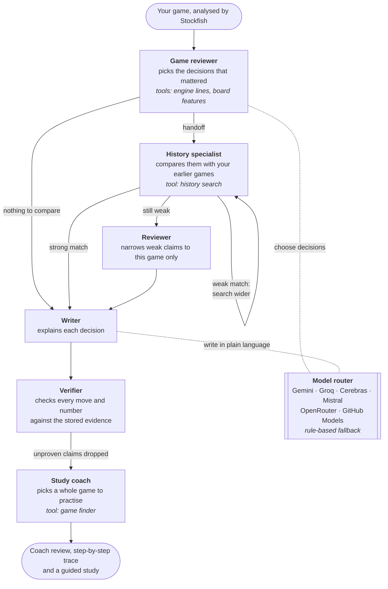

# Chess Game Review

**See how your chess decisions change over time, and find the mistakes you keep repeating.**

### ▶ [Open Chess Game Review](https://chess-game-review-gr1u.onrender.com)

Works with **Lichess**, **Chess.com** and **PGN files**. Free, no account needed.

[](https://github.com/abi1010-git/chess-game-review/actions/workflows/tests.yml)

---

## What it does

Most game reviews look at one game at a time, so it's hard to notice patterns. Chess Game Review looks at your games together and answers questions like:

- **What do I keep getting wrong?** A mistake only counts as *recurring* once it shows up across several games, and the app tells you how often you met that kind of position and how often it went wrong.
- **Am I improving?** Accuracy by month, and mistake rates in the opening, middlegame and endgame.
- **Why did I lose this game?** It separates the earlier move that made things difficult from the move that actually lost, and any later chance you missed.
- **Did I handle this better before?** Key decisions in a game are compared with your own earlier decisions in the same or similar positions.
- **What should I study next?** One or two whole games picked to practise your most frequent issue, with guided checkpoints that keep the answer hidden until you ask.
- **Can a coach walk me through it?** A coach review compares a game's key decisions with your earlier games and recommends a game to study, with every claim checked against the engine's evidence.

Every move you play is checked by **Stockfish 18**. Explanations come from the engine's lines and the board itself (lost material, forks, pawn breaks, king safety, passed pawns). When an AI model is available it can choose what to compare and write the explanations in plainer language, but every move and number it mentions is checked against the stored evidence first, and anything it can't back up is replaced with the standard explanation. When the engine's quick check and its deeper check disagree, the finding is marked **uncertain**.

Forced moves, obvious recaptures and positions that were already won or lost are not judged, so you only see decisions that mattered.

## The agentic AI coach

The coach review is a **multi-agent system** built with [LangGraph](https://github.com/langchain-ai/langgraph). Five specialist agents share one typed state. They call tools, hand work to each other and decide the next step from what they find, including going back to search again when the evidence is weak.



What makes it agentic rather than a single prompt:

- **Decisions, not a script.** The reviewer chooses which moments to examine. The history specialist chooses how to search (exact position, then pawn structure, then the kind of decision, then the game phase) and when a match is good enough.
- **Tool use.** Agents call the engine's lines, board-feature detectors, a search over your past games and a game finder, instead of guessing.
- **Handoffs with conditional routing.** Each agent passes typed results to the next, and the graph picks the next agent from the state: search again, narrow the claim or move on.
- **Self-correction.** A weak comparison triggers a wider search. If the evidence is still thin, the claim is narrowed to "this game only" rather than overstated.
- **Guardrails.** A verifier checks every move and number against stored evidence before anything is shown. Handoffs, searches and tool calls are capped, so a review always finishes.
- **Multi-model routing.** Model calls go to whichever free provider has quota, with automatic failover. If none can answer, the coach falls back to rules and still works.
- **Transparent.** Every step is recorded. Open **Show how the coach worked** on a review to see each handoff and tool call.

## How to use it

1. **Open the [app](https://chess-game-review-gr1u.onrender.com).** If it hasn't been used for a while, the first load can take about a minute while the server wakes up.
2. **Import your games.** Enter a Lichess or Chess.com username, or upload a PGN file. For a PGN, choose which player is you.
3. **Pick games to analyze.** Filter by date, time control, colour or result and select games, or use **Suggest a set** to compare a recent period with your earlier games at a similar rating.
4. **Wait for the analysis.** The **Analysis** tab shows progress. Each game takes a few minutes.
5. **Read your results.** **Your progress** shows trends, recurring mistakes and strengths. Click any game to open its report: the board, every move, a graph of your winning chances, findings by phase and comparisons with your earlier games. Press **Review with coach** for a guided comparison.
6. **Study a game.** Under **What to Study Next**, pick a game. Play through it, and at each checkpoint write down your plans, choose a move and predict the reply before you reveal what the engine thinks. Your notes are saved.

### Tips

- **Start with 10 to 20 games.** The free server analyses one game at a time.
- **Use one time control** (for example only rapid). Blitz and classical decisions aren't really comparable.
- **Watch the sample sizes.** Months with fewer than 3 games are drawn hollow, and comparisons need at least 3 earlier games before they give a verdict.

## Good to know

- **Your games are not kept on the public site.** It runs on a free server that resets when it restarts or sleeps, which clears imported games and analyses. To keep your history, run the app on your own computer (see below).
- **There are no accounts yet.** Everyone using the public link shares the same space, so others may see games imported there.
- **Only public games** can be imported from Lichess and Chess.com. Variants such as Chess960 are skipped.

---

## For developers

The app is a FastAPI backend with a separate analysis worker that runs Stockfish, and a React + TypeScript frontend.

### Run it on your computer

Requirements: Python 3.12 or newer, Node 20 or newer, and [Stockfish 18](https://stockfishchess.org/download/). Put the Stockfish binary in `backend/engines/`, put `stockfish` on your PATH, or set `STOCKFISH_PATH`.

```bash
# 1. API
cd backend
python -m venv .venv
.venv/Scripts/python -m pip install -r requirements-dev.txt   # macOS/Linux: .venv/bin/python
.venv/Scripts/python -m uvicorn app.main:app --port 8000

# 2. Analysis worker (second terminal)
cd backend
.venv/Scripts/python -m app.worker        # --threads N runs N engines in parallel

# 3. Website (third terminal)
cd frontend
npm install
npm run dev                               # http://localhost:5173
```

Your games are stored in `backend/data/app.db` and are kept between runs.

Run the tests with `cd backend && .venv/Scripts/python -m pytest -q`. The tests in `test_milestone_engine.py` use real Stockfish on hand-checked positions and are skipped when no engine is found; the rest use a small fake engine.

### Run it with Docker

The `Dockerfile` builds the website, installs Stockfish 18 and starts the API and the worker together:

```bash
docker build -t chess-game-review .
docker run -p 7860:7860 -v chess-data:/data chess-game-review
```

The public site runs this image on [Render](https://render.com)'s free plan (512 MB of memory, so one engine).

### How the analysis works

- Each game is replayed from its starting position. Every position gets a first pass (150k nodes, top 3 lines), and close or critical decisions get a deeper second pass (600k nodes). A verdict that changes between passes is marked uncertain.
- Scores are converted to winning chances with the same curve Lichess uses, so a move that keeps a won position won isn't flagged. Inaccuracy, mistake and blunder mean losing 5, 10 and 20 points of winning chance.
- The engine settings are fixed per **analysis version** (v1: Stockfish 18, one thread, 64 MB hash), so results stay comparable over time. Changing them means starting a new version.
- Similar decisions are matched by exact position first, then by the same material and pawn structure, then by the same kind of decision in the same phase.
- Jobs are claimed with a lease and results are written in the same transaction that marks the job done, so a cancelled or restarted job never leaves half-written results.

### How the coach works

The coach is a [LangGraph](https://github.com/langchain-ai/langgraph) workflow of specialists with typed inputs and outputs (see the [diagram above](#the-agentic-ai-coach); the graph is built in `backend/app/coach/review.py`):

- **Game reviewer** picks the decisions worth comparing and calls tools for the engine's line and the board features.
- **History specialist** searches your earlier games: exact position first, then the same pawn structure, then the same kind of decision. When a match is weak it searches again more broadly; when it is still weak it tells the reviewer to narrow the claim to this game only.
- **Writer** drafts each explanation from templates, or with an AI model when one is configured.
- **Verifier** checks every referenced move exists and that the text names no move or number outside the evidence.
- **Study coach** picks a whole game that shows the same kind of decision, skipping games that are too forced or have no clear lesson.

Handoffs, searches and tool calls are capped, and every step is recorded so you can see how a review was made (**Show how the coach worked**). Reviews are saved, so asking again costs no model quota.

AI calls go through a router that tries free providers in order of quality (Gemini, Groq, Cerebras, Mistral, OpenRouter, GitHub Models), skips any that is rate-limited or over the app's own budget, and moves on when a reply fails, times out or can't be verified. If none can answer, the rule-based text is used. Keys are read only from environment variables and are never shown by the app.

### Configuration

| Variable | Default | Purpose |
| --- | --- | --- |
| `DATABASE_URL` | SQLite in `backend/data/` | Set to `postgresql+psycopg://…` for PostgreSQL (install `psycopg[binary]`) |
| `CHESS_REVIEW_DATA_DIR` | `backend/data` | Where the SQLite database is kept |
| `STOCKFISH_PATH` | PATH, then `backend/engines/` | Stockfish binary for the worker |
| `WORKER_THREADS` | 2 (1 in Docker) | Parallel single-threaded engines in one worker |
| `ANALYSIS_VERSION` | `v1` | Change when engine settings change, so games show as needing new analysis |
| `MAX_UPLOAD_BYTES` | 5 MB | Largest PGN file accepted |
| `MAX_GAMES_PER_IMPORT` | 2000 | Most games one account import can fetch |
| `MAX_GAMES_PER_BATCH` | 500 | Most games in one analysis batch |
| `CORS_ORIGINS` | `http://localhost:5173` | Allowed frontend origins |
| `WORKER_LEASE_SECONDS` | 300 | How long a job stays claimed without a heartbeat |
| `ENGINE_ALLOW_MISMATCH` | off | Set to `1` to run a different engine build than the analysis version names |
| `GEMINI_API_KEY`, `GROQ_API_KEY`, `CEREBRAS_API_KEY`, `MISTRAL_API_KEY`, `OPENROUTER_API_KEY`, `GITHUB_MODELS_TOKEN` | none | Free-tier AI providers for the coach. Set any you have; with none, the coach uses its rule-based mode |
| `LLM_ORDER` | quality order | Preferred providers, e.g. `gemini,groq,openrouter` |
| `<NAME>_MODEL` | see `coach/llm.py` | Model for one provider, e.g. `GEMINI_MODEL` |
| `LLM_<NAME>_RPM`, `LLM_<NAME>_RPD` | below each free tier | The app's own per-minute and per-day budget for one provider |
| `COACH_MODEL_RUNS_PER_HOUR` | 20 | AI-written reviews per visitor per hour before falling back to rules |
| `LLM_DISABLED` | off | Set to `1` to never call a model |

### Project layout

```
backend/app/
  importers/      Lichess and Chess.com adapters, PGN import and duplicate detection
  selection.py    game filters and "Suggest a set"
  jobs.py         analysis queue with leases and retries
  engine.py       Stockfish over UCI
  analysis.py     two-pass analysis and per-move evidence
  features.py     board features (material, pawn structure, king safety, mobility)
  findings.py     mistake and strength detectors
  compare.py      matching similar decisions, loss explanations, game reports
  dashboard.py    "Your progress"
  coach/          phase 3: LangGraph specialists (reviewer, history, study coach), tools, verifier, LLM router
  worker.py       the analysis worker
  main.py         API routes, and serves the built website
backend/tests/    unit and API tests
frontend/src/     React screens: Import, Pick games, Analysis, Your progress, Suggest a set, Game report, Coach review, Study
```

### Planned

- An evaluation of the coach: AI-written against rule-based reviews, on the same games.
- Accounts, so each player has their own private history.
